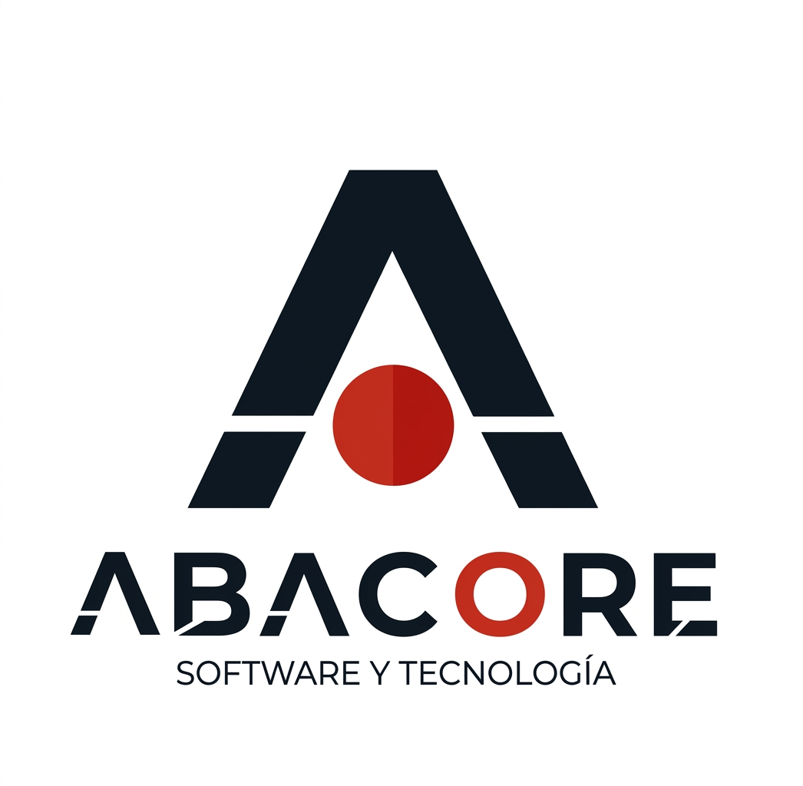
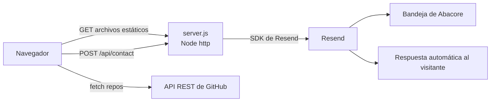

<div align="center">
  
  <h1>Abacore S.A.S. — Landing page</h1>
  <p><b>Sitio corporativo de Abacore S.A.S., firma de desarrollo de software del Meta, Colombia</b><br/>HTML, CSS y JavaScript sin frameworks, con un micro-servidor Node para el formulario de contacto</p>

  
  
  
  
  
  <a href="LICENSE"></a>
</div>

<details>
<summary><b>English summary</b></summary>

Corporate landing page for Abacore S.A.S., the software company founded by Darwin Aveiga in Meta, Colombia. It is built with semantic HTML, modular CSS with design tokens and vanilla JavaScript ES modules, without any frontend framework. A small Node.js server (native `http` module) serves the static files and exposes `POST /api/contact`, which sends the lead to the company inbox and an automatic reply to the visitor through Resend. The projects section loads selected repositories from the GitHub REST API. Status: version 1.0.0, run locally with `npm start`; there is no deployment configuration in the repository yet.

</details>

## Qué es

Este repositorio contiene la landing page de **Abacore S.A.S.**, la empresa de desarrollo de software que fundé en el Meta. El sitio presenta la empresa (incluido el origen del nombre: *Aba*, raíz sikuani, y *Core*, núcleo), los servicios que ofrece, algunos proyectos recientes y un formulario para que un cliente potencial escriba directamente.

La decisión técnica principal fue no usar frameworks: todo el frontend está hecho con HTML semántico, CSS dividido por componentes y módulos ES de JavaScript. El único código de servidor es un micro-servidor en Node que sirve los archivos y guarda la clave de Resend fuera del navegador.

## Funcionalidades

| Sección | Qué hace |
| --- | --- |
| Navegación | Barra fija con logo, enlaces ancla y menú desplegable en móvil (`js/navbar.js`). |
| Inicio | Mensaje principal, llamados a la acción hacia servicios y "Nosotros". |
| Nosotros | Origen del nombre y los tres ejes de la firma: arquitectura, soluciones integrales y visión global. |
| Servicios | Seis tarjetas: desarrollo web, aplicaciones web, apps móviles, software de escritorio, automatizaciones y consultoría técnica. |
| Proyectos | Tarjetas generadas en el navegador: consulta los repositorios `EduVault` y `MediLink` en la API REST de GitHub y añade la ficha del proyecto privado `AVTech`, definida en `js/api.js`. Muestra estados de carga y de error. |
| Contacto | Formulario (nombre, correo, asunto, mensaje) que envía `POST /api/contact`. El servidor manda el mensaje a la bandeja de la empresa y una respuesta automática al visitante, ambas con plantillas HTML en los colores de la marca. |

## Arquitectura



- **Sin frameworks ni paso de build.** El navegador carga `index.html`, nueve hojas de estilo y `js/app.js` como módulo ES; no hay bundler ni transpilación.
- **Diseño por tokens.** `css/variables.css` define la paleta de marca (navy `#1A1F2E`, rojo `#C0392B` y sus variantes), tipografías (Inter y Outfit), sombras, radios y transiciones. Cada sección tiene su propia hoja (`hero.css`, `services.css`, `contact.css`, etc.).
- **JavaScript separado por responsabilidad.** `app.js` arranca la página, `api.js` obtiene los datos de GitHub, `ui.js` pinta las tarjetas y estados, y `navbar.js` controla el menú.
- **La clave de correo nunca llega al cliente.** El navegador solo conoce `/api/contact`; la clave de Resend (`EMAIL_API`) vive en el `.env` del servidor.
- **Servidor mínimo.** `server.js` usa el módulo `http` nativo de Node, sin Express: resuelve el tipo MIME de los estáticos y atiende el único endpoint del formulario.

## Stack tecnológico

| Capa | Tecnología |
| --- | --- |
| Marcado | HTML5 semántico |
| Estilos | CSS3 modular con variables (tokens de diseño), Google Fonts (Inter, Outfit) |
| Lógica de cliente | JavaScript con módulos ES, `fetch` |
| Servidor | Node.js (módulo `http`), dotenv 16 |
| Correo | Resend 4 (SDK de Node) |
| Datos de proyectos | API REST pública de GitHub |

## Puesta en marcha

Requisitos: Node.js 18 o superior y una cuenta de Resend con el dominio remitente verificado.

```bash
git clone https://github.com/Joan-Mora/Abacore-S.A.S.git
cd Abacore-S.A.S
npm install
```

Crea un archivo `.env` en la raíz (está en `.gitignore`) con estas variables:

| Variable | Propósito |
| --- | --- |
| `EMAIL_API` | Clave de la API de Resend. |
| `PORT` | Opcional. Puerto del servidor; por defecto `3000`. |

Arranca el servidor:

```bash
npm start
```

El sitio queda en `http://localhost:3000`. `npm run dev` ejecuta el mismo comando.

Los remitentes de los correos están definidos en `server.js` con el dominio `abacore.co`; para enviar desde otro entorno, ese dominio (u otro que lo reemplace) debe estar verificado en Resend.

## Pendientes

- No hay configuración de despliegue (Dockerfile, `render.yaml` o similar) en el repositorio.
- Antes de exponer `server.js` en producción conviene endurecerlo: restringir las rutas de archivos que puede servir, escapar el contenido del formulario en las plantillas de correo, limitar CORS al dominio propio y poner un tope al tamaño del cuerpo y a la frecuencia de envíos.
- La sección de proyectos hace peticiones a GitHub sin autenticación, sujetas a su límite de 60 por hora por IP; si una falla, se muestra el mensaje de error de toda la sección.

## Estructura del repositorio

```
assets/img/Logo.png   Logo de la marca (también favicon)
css/                  variables.css (tokens) + una hoja por sección
js/app.js             Arranque, carga de proyectos y formulario
js/api.js             Consulta a la API de GitHub y ficha de AVTech
js/ui.js              Renderizado de tarjetas y estados
js/navbar.js          Menú y comportamiento de la barra
index.html            Página única
server.js             Micro-servidor Node: estáticos + /api/contact
package.json          Scripts y dependencias (dotenv, resend)
```

## Autoría

<table>
  <tr>
    <td align="center"><a href="https://github.com/Joan-Mora"><br/><b>Darwin Joan Aveiga Mora</b></a><br/><sub>Fundador de Abacore S.A.S. · diseño y desarrollo full stack</sub></td>
  </tr>
</table>

## Licencia

Copyright © 2026 Darwin Joan Aveiga Mora. **Todos los derechos reservados.**

Este repositorio es público para que el código pueda consultarse como parte de mi portafolio. Eso no concede permiso para copiarlo, reutilizarlo, modificarlo, distribuirlo ni presentarlo como trabajo propio. Los términos completos están en [`LICENSE`](LICENSE). Para cualquier uso, escribe a [darwin@abacore.co](mailto:darwin@abacore.co).

El nombre y el logo de Abacore S.A.S. son marcas de la empresa.

<div align="center">
<sub>Hecho por <a href="https://github.com/Joan-Mora">Darwin Aveiga</a> · <a href="https://abacore.co">Abacore S.A.S.</a></sub>
</div>
